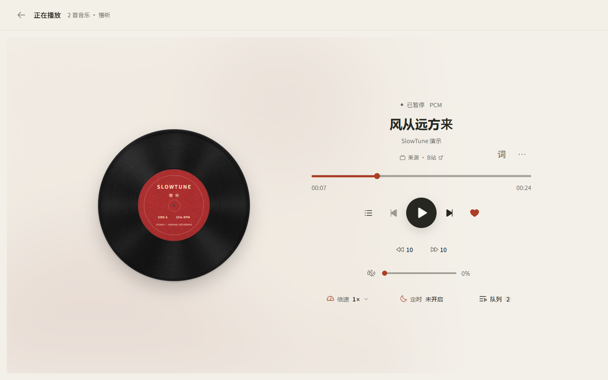
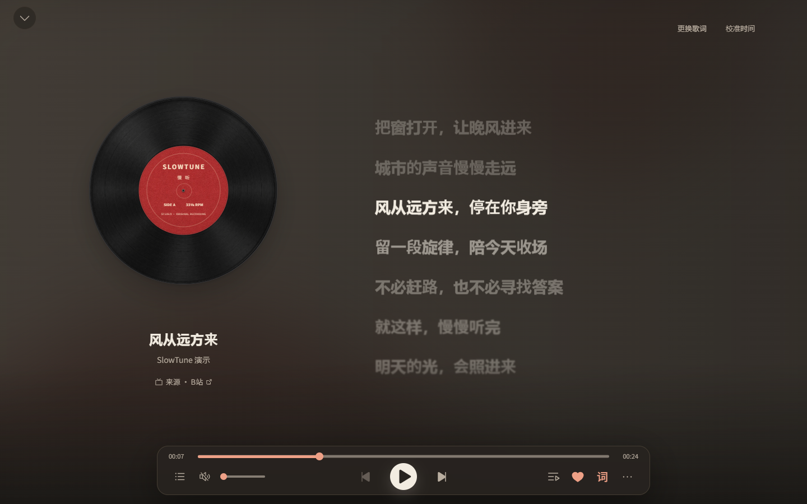
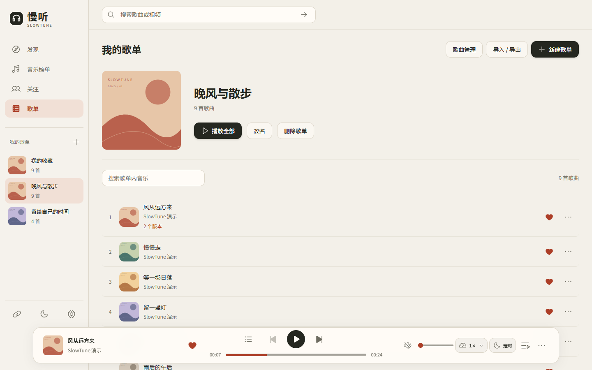

# 慢听 SlowTune

发现喜欢的音乐，留下想听的版本。

慢听是一款面向 Windows 的个人音乐播放器。搜索 B站音乐、整理自己的歌单，在唱片与歌词之间切换，让音乐陪你工作、散步或度过一个安静的夜晚。

[下载 Windows 预览版](https://github.com/xiaoxiaosu25/slowtune/releases) · [功能介绍](#功能) · [源码启动](#源码启动) · [反馈问题](https://github.com/xiaoxiaosu25/slowtune/issues)



*截图展示当前桌面源码界面，使用虚构歌曲、原创演示歌词与示意封面。发行包的界面和功能以对应 Release 为准。*

**当前为开发预览版。** 主要维护 Windows 桌面，部分真实设备场景仍在验证。

## 下载 Windows 版

1. 打开 [Releases](https://github.com/xiaoxiaosu25/slowtune/releases)，选择标记为 **Pre-release** 的版本。
2. 下载附件中名称为 `SlowTune-<版本>-windows-x64.zip` 的程序包，完整解压到当前用户可写的目录。
3. 双击 `SlowTune.exe`，欢迎页结束后即可进入。无需另装 Node.js。

请保留完整解压目录；GitHub 自动生成的 `Source code.zip` 是源码，不能直接作为程序运行。更新前退出慢听，备份并保留 `SlowTune.exe` 同级的 `data/` 文件夹。

当前程序未签名，没有安装器或自动更新；支持范围与设备验证情况见[当前限制](docs/产品/当前限制.md)。

## 功能

### 从发现到播放

通过 B站搜索、推荐、音乐榜单与应用内关注更新发现音乐。榜单中的歌曲会在支持的视频来源中匹配播放，也可以手动搜索并选择喜欢的版本。

播放队列支持重排、顺序、随机与循环，提供倍速、快进退和睡眠定时。桌面定时支持倒计时、自然播完 N 首或播完当前曲，可选择暂停、停止；独立桌面程序还支持到时退出慢听。

### 跟着歌词，听完整首歌

一键进入沉浸歌词：左侧保留唱片或封面，右侧跟随播放进度显示歌词，底部集中控制播放。也可以开启独立桌面悬浮歌词，在使用其他窗口时继续看词。



支持歌词自动匹配、人工选择、LRC／文本导入和时间偏移校准。有真实逐字时间的数据按逐字呈现，普通 LRC 按整句高亮。

### 一首歌，保留多个版本

把喜欢的音乐加入收藏与歌单，为同一首歌保留录音室、现场、翻唱等不同版本。可设置歌曲默认版本，也可以为某条歌单记录固定版本，切换时不用重新整理歌单。



歌单支持封面更换、搜索、排序与 JSON 导入导出。歌曲资料与播放版本分别管理，方便整理歌名、歌手和来源。

### 按自己的习惯使用

| 能力 | 可以做什么 |
| --- | --- |
| 主题与外观 | 跟随系统、白天或黑夜，选择暖纸炭黑、经典薄荷、晴樱粉或珊瑚红配色 |
| B站账号 | 扫码登录，预览并确认本地歌单与 B站收藏夹的关联 |
| 可选 YouTube | 默认关闭；配置网络和取源工具后可手动启用 |
| 本地资料 | 独立桌面资料保存在程序旁的 `data/`，可在设置中打开资料目录 |

完整操作范围见[产品功能](docs/产品/产品功能.md)，资料保存与备份见[运行维护](docs/运维/运行维护.md#windows-桌面运行)。

## 使用说明

- B站和 YouTube 使用非官方接入方式，功能可用性受平台接口、账号权限、地区和网络影响。
- YouTube 默认关闭，启用前需配置网络和外部取源工具，见[来源工具与账号](docs/运维/运行维护.md#来源工具与账号)。
- 开启B站收藏夹关联后，本地新增和删除可能同步修改远端收藏夹；请先核对关联预览。
- 当前不提供音视频下载或完整离线曲库。歌单 JSON 仅备份歌曲资料；完整备份请退出程序后复制整个 `data/`。

## 源码启动

需要 Windows、Git 和 Node.js `>=24.15.0`（含 npm）。

```powershell
git clone https://github.com/xiaoxiaosu25/slowtune.git
cd slowtune
npm ci
npm run desktop:build
npm run desktop
```

构建完成后，也可双击仓库根目录的 `一键启动.cmd` 打开应用。

## 参与贡献

欢迎通过 [Issues](https://github.com/xiaoxiaosu25/slowtune/issues) 反馈问题或提出建议，通过 Pull Request 改进代码和文档。

开发环境、代码目录和提交说明见[贡献指南](CONTRIBUTING.md)，其他文档见[文档导航](docs/文档导航.md)。

## 许可证

本项目采用 [AGPL-3.0-only](LICENSE)，版权说明见 [NOTICE](NOTICE)。第三方依赖、字体和素材的许可见[第三方声明](第三方声明.md)。
