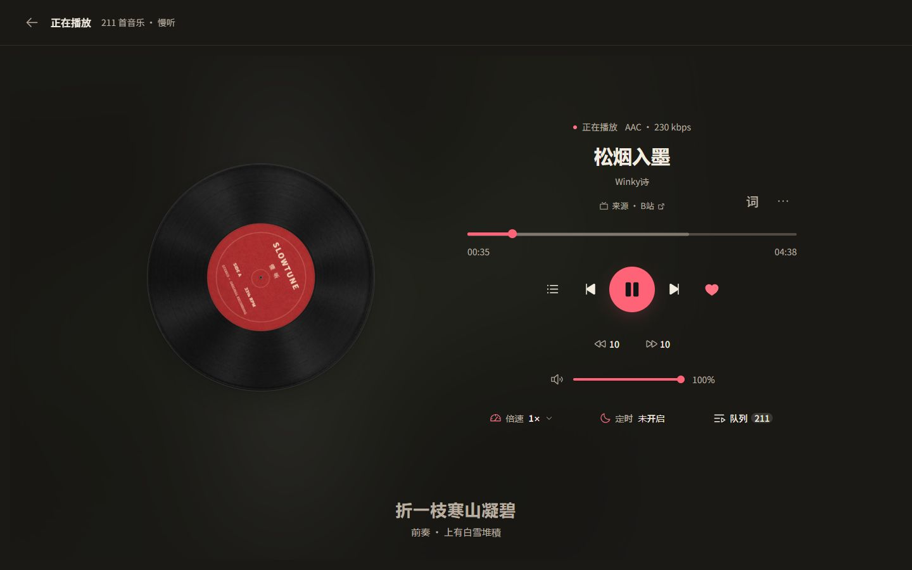
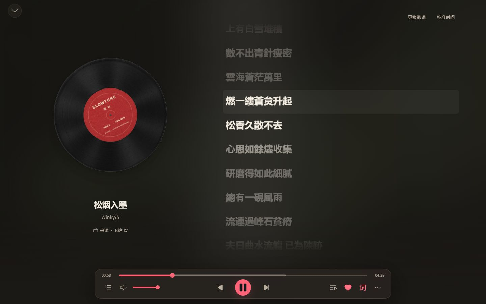
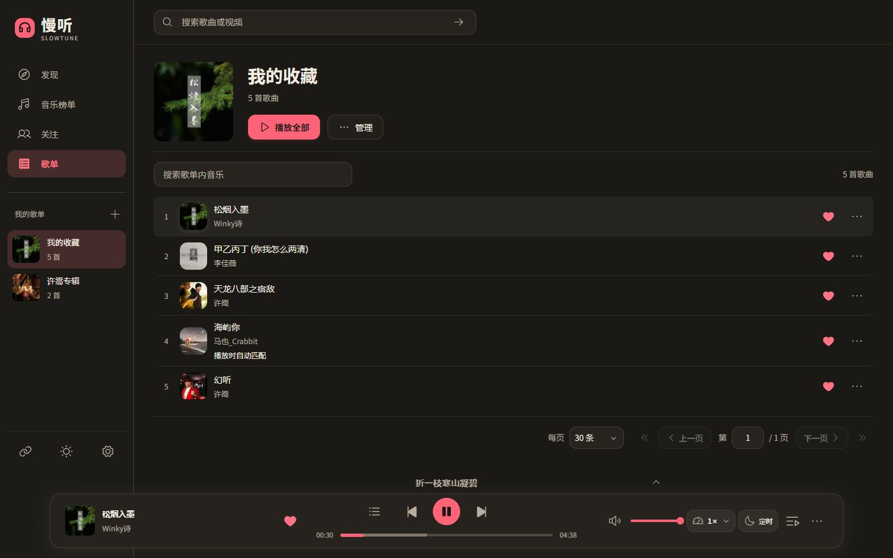
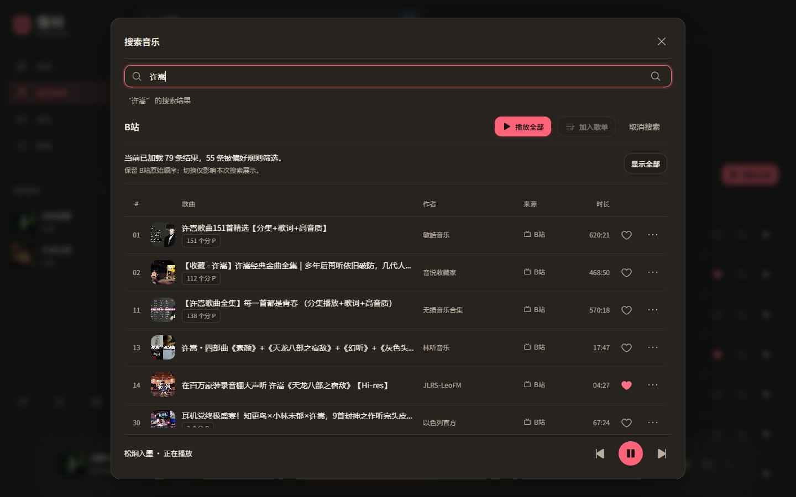
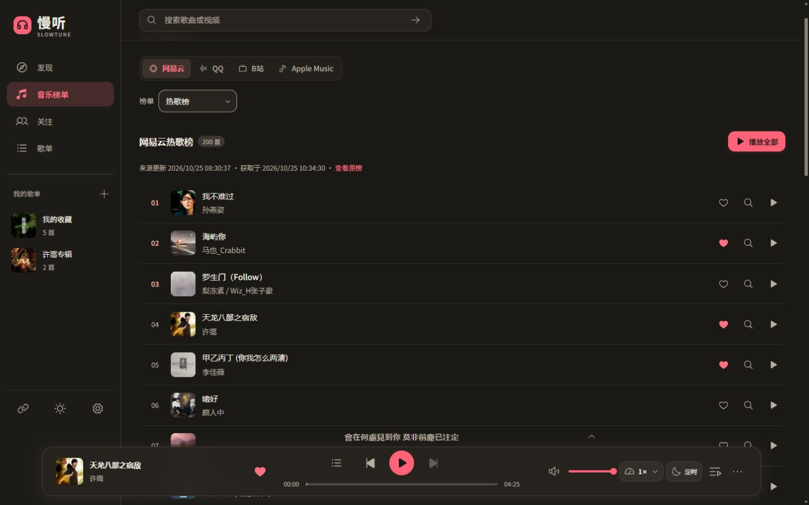
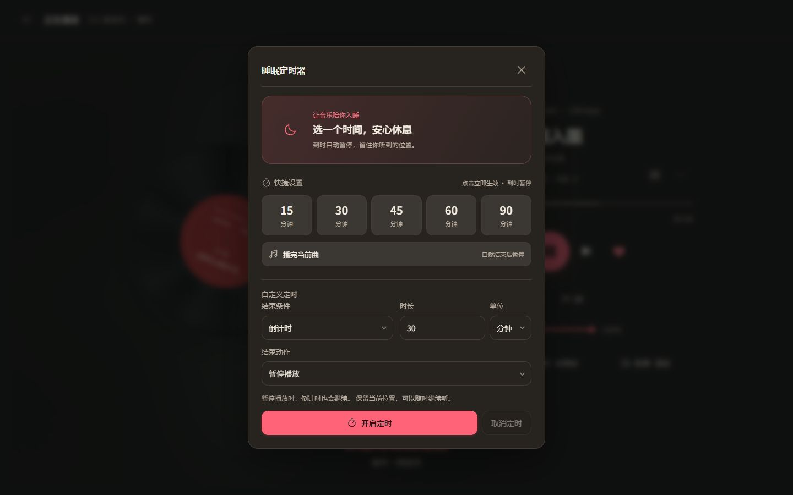
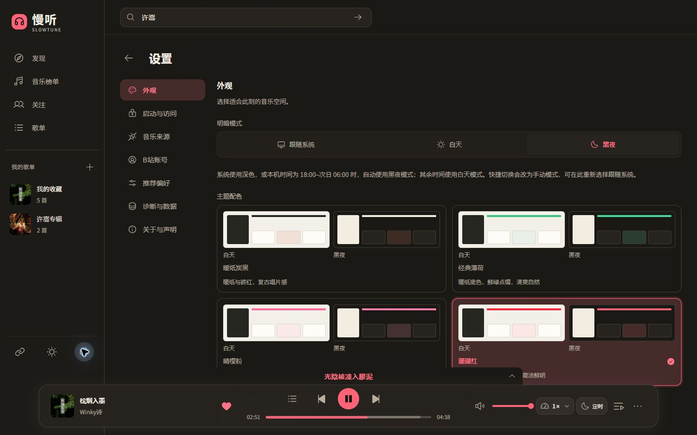
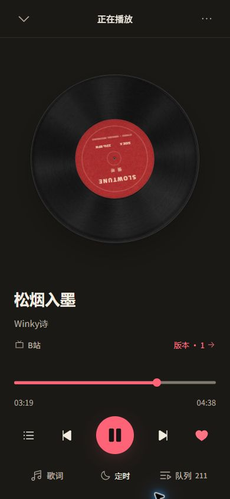
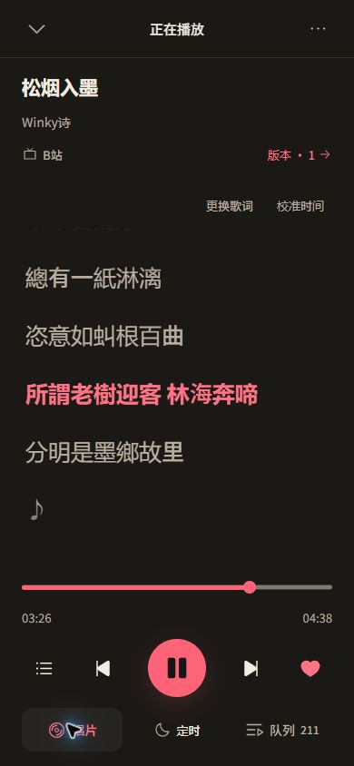

<h1 align="center">慢听 SlowTune</h1>

<p align="center"><strong>发现喜欢的音乐，留下想听的版本。</strong></p>

<p align="center">面向 Windows 的个人音乐播放器：从 B站发现音乐，用歌单和多版本整理喜欢的歌，搭配沉浸歌词与桌面悬浮歌词。</p>

<p align="center">
  <a href="https://github.com/xiaoxiaosu25/slowtune/releases/latest"></a>
  <a href="https://github.com/xiaoxiaosu25/slowtune/releases"></a>
  <a href="LICENSE"></a>
</p>

<p align="center">
  <a href="https://github.com/xiaoxiaosu25/slowtune/releases/download/v0.1.33/SlowTune-0.1.33-windows-x64.zip"><strong>下载 Windows x64</strong></a> ·
  <a href="https://github.com/xiaoxiaosu25/slowtune/releases">所有版本与更新记录</a> ·
  <a href="#界面预览">界面预览</a> ·
  <a href="#功能">功能</a> ·
  <a href="#移动网页">手机网页</a> ·
  <a href="#源码启动">源码启动</a> ·
  <a href="https://github.com/xiaoxiaosu25/slowtune/issues">反馈问题</a>
</p>



<p align="center"><em>《松烟入墨》· Winky诗，真实 B站来源播放画面。</em></p>

**Windows x64 免安装版，解压后双击 `SlowTune.exe`，无需另装 Node.js。** [下载与启动](#下载-windows-版) · [支持范围与当前限制](docs/产品/当前限制.md)

## 功能

| 功能 | 可以做什么 |
| --- | --- |
| 发现与搜索 | 浏览 B站推荐、应用内关注更新，按歌名／歌手搜索，或粘贴支持的来源链接 |
| 多平台榜单 | 查看网易云、QQ、B站与 Apple Music 榜单，从支持的视频来源匹配播放，也可手动挑选版本 |
| 播放展示 | 切换唱片、方形、慢转圆形、横向音波与圆形音环，音波跟随真实音频频谱 |
| 沉浸与悬浮歌词 | 自动匹配、手动选择、导入 LRC／文本和时间校准；Windows 独立程序支持桌面悬浮歌词 |
| 歌单与歌曲多版本 | 收藏与自建歌单，封面、搜索、排序和重排；同一首歌可保留多个版本，设置默认版本或歌单固定版本 |
| 队列与播放控制 | 顺序、随机、列表／单曲循环，队列重排、倍速、进度、音量与快进退 |
| 睡眠定时 | 倒计时、自然播完 N 首或播完当前曲；结束时暂停、停止，Windows 独立程序还可退出慢听 |
| 外观与资料 | 四套配色、明暗模式、自定义欢迎页；B站扫码登录与收藏夹关联，歌单 JSON 导入导出 |

榜单用于发现歌曲，播放时从 B站等支持的视频来源匹配或挑选版本。完整操作说明见[产品功能](docs/产品/产品功能.md)。YouTube 可按需启用，默认关闭，需另行配置网络与取源工具。

## 界面预览

截图来自实际运行的服务网页，点击可看大图。PC 网页显示底部歌词，Windows 程序使用桌面悬浮歌词。

| 沉浸歌词 | 收藏与歌单 |
| :---: | :---: |
| [](docs/images/lyrics.jpg) | [](docs/images/library.jpg) |
| 唱片与歌词同屏，跟随进度阅读，也可更换歌词或校准时间。 | 收藏喜欢的歌，换封面、搜歌、排序，并管理歌曲的不同播放版本。 |

| 搜索喜欢的版本 | 多平台音乐榜单 |
| :---: | :---: |
| [](docs/images/search.jpg) | [](docs/images/charts.jpg) |
| 保留来源结果与分 P 信息，筛选偏好可调整，听之前先挑喜欢的版本。 | 单首点播或播放整榜，收藏歌曲，也能打开搜索选择其他版本。 |

| 睡眠定时 | 外观与主题 |
| :---: | :---: |
| [](docs/images/sleep-timer.jpg) | [](docs/images/appearance.jpg) |
| 再听一会，或等这一首自然结束，让音乐陪你入睡。 | 选择白天、黑夜或跟随系统，搭配自己喜欢的主题色。 |

## 移动网页

手机浏览器连接电脑上单独启动的服务版，可浏览“发现、音乐库、我的”，使用迷你播放器、完整播放页与直接歌词切换。返回浏览后保留原来的页面上下文。

| 音乐库 | 完整播放 | 歌词阅读 |
| :---: | :---: | :---: |
| <a href="docs/images/mobile-library.jpg"></a> | <a href="docs/images/mobile-player.jpg"></a> | <a href="docs/images/mobile-lyrics.jpg"></a> |

手机与 PC 网页连接同一服务时，共享歌曲、歌单和收藏，队列和主题等偏好由各自浏览器保存。Windows 独立桌面与服务版各自保存资料。连接方式见[手机与局域网访问](docs/运维/运行维护.md#手机与局域网访问)；Android／iOS 原生客户端与独立手机运行时尚未提供。

## 下载 Windows 版

1. [下载 Windows x64 ZIP](https://github.com/xiaoxiaosu25/slowtune/releases/download/v0.1.33/SlowTune-0.1.33-windows-x64.zip)；其他版本及更新说明见 [Releases](https://github.com/xiaoxiaosu25/slowtune/releases)。
2. 将 `SlowTune-<版本>-windows-x64.zip` 完整解压到当前用户可写的目录。
3. 双击 `SlowTune.exe`，欢迎页结束后即可进入，无需另装 Node.js。

下载包对应已发布版本，功能与变更见对应 Release；源码分支可能包含尚未发布的调整。

请保留完整解压目录。GitHub 自动生成的 `Source code.zip` 是源码，不能直接作为程序运行。

**更新与备份：** 先退出慢听，备份并保留 `SlowTune.exe` 同级的整个 `data/` 文件夹。完整解压新版本后保留自己的资料，具体方法见[更新与恢复](docs/运维/运行维护.md#更新与恢复)。

当前程序未签名，没有安装器或自动更新；设备验证范围见[当前限制](docs/产品/当前限制.md)。

## 使用说明

- B站和 YouTube 使用非官方接入方式，功能可用性受平台接口、账号权限、地区和网络影响。
- YouTube 默认关闭，启用前需配置网络和外部取源工具，见[来源工具与账号](docs/运维/运行维护.md#来源工具与账号)。
- 开启B站收藏夹关联后，本地新增和删除可能同步修改远端收藏夹；请先核对关联预览。
- 当前不提供音视频下载或完整离线曲库。歌单 JSON 仅备份歌曲资料；完整备份请退出程序后复制整个 `data/`。

## 源码启动

需要 Windows、Git 和 Node.js `>=24.15.0`（含 npm）。

```powershell
git clone https://github.com/xiaoxiaosu25/slowtune.git
cd slowtune
npm ci
npm run desktop:build
npm run desktop
```

构建完成后，也可双击仓库根目录的 `一键启动.cmd` 打开应用。

## 参与贡献

欢迎通过 [Issues](https://github.com/xiaoxiaosu25/slowtune/issues) 反馈问题或提出建议，通过 Pull Request 改进代码和文档。

开发环境、代码目录和提交说明见[贡献指南](CONTRIBUTING.md)，其他文档见[文档导航](docs/文档导航.md)。

## 许可证

本项目采用 [AGPL-3.0-only](LICENSE)，版权说明见 [NOTICE](NOTICE)。第三方依赖、字体和素材的许可见[第三方声明](第三方声明.md)。
