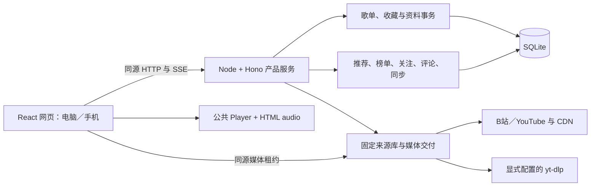

# 架构与数据

本文按当前源码说明运行链路与已有独立模块。歌曲资料库、维护、备份、播放和同步统一使用产品新模型；桌面与独立手机端安排见[桌面应用方案](../计划/桌面应用方案.md)。

## 当前运行结构

网页资源由服务读取 `dist/client`，服务程序从 `dist/server/index.js` 启动。生产使用同一 Origin；当前没有 Vite 开发代理配置或独立前端开发启动脚本。`npm start` 运行正式构建，不负责构建或安装。

Windows 桌面宿主位于 `desktop/`，显式使用普通 Node 启动或复用所选服务。`src/desktop-host.ts` 只在 Electron 注入有限桥接时发布歌词与实际时钟，普通浏览器和手机路径不建立宿主订阅或计时器；透明歌词窗口仅消费该数据，不创建音频或访问业务服务。主窗口与歌词窗口均保留沙箱、上下文隔离与网页安全检查，IPC 校验窗口、主框架和预期页面 URL，拒绝跨窗口和非预期导航。

桌面资料统一在项目根或 EXE 同级的 data。窗口与歌词偏好为 desktop-state.json，端口无关的队列与外观为 preferences.json，Electron 浏览器资料为 profile；数据库、内部配置、运行记录、缓存与日志分目录保存。宿主校验本地路径、归属与 PID 后建立 HttpOnly 会话，不继承服务版配置、不接管其进程。白名单偏好桥接在界面初始化前恢复，普通浏览器仍沿原 localStorage。归属与异常处理见[桌面应用方案](../计划/桌面应用方案.md#本地资料与实例边界)。

## 目录和职责

| 位置 | 当前职责 |
| --- | --- |
| [src/App.tsx](../../src/App.tsx) | 页面装配、会话、资料读写、搜索、歌曲动作与共享状态 |
| `src/EntryGate.tsx`、`src/startup.ts` | 欢迎入口、访问策略读取、并行预加载及向首页交接请求 |
| `server/startup-settings.ts` | 按用户空间保存访问策略、scrypt 访问码摘要、欢迎图与构图 |
| [src/playback.ts](../../src/playback.ts)、[src/playback-recovery.ts](../../src/playback-recovery.ts) | 浏览器播放器、队列、延迟取源、会话内故障断点与手动恢复、来源关闭与播放意图 |
| [src/PlayingArtwork.tsx](../../src/PlayingArtwork.tsx)、[src/PlayingSpectrum.tsx](../../src/PlayingSpectrum.tsx)、[src/audio-analysis.ts](../../src/audio-analysis.ts) | 桌面六种封面展示、保留手机既有七种展示与浏览器偏好，固定中线频谱与独立音环，惰性 Web Audio 分析 |
| [src/](../../src) 下的页面与面板 | 发现、榜单、关注、歌单、评论、设置与批量操作界面 |
| [src/theme.ts](../../src/theme.ts)、[styles.css](../../src/styles.css) | 外观偏好与全站样式 |
| [server/index.ts](../../server/index.ts) | HTTP 中间件、身份、模块装配、路由、预热和生命周期 |
| `server/bilibili-accounts.ts`、`bilibili-credentials.ts` | 账号会话与 Windows 凭据持久化 |
| `server/bilibili-favorites.ts`、`song-library-sync.ts` | 远端收藏夹访问、成员贡献／映射、完整远端观察与持久意图执行 |
| `server/discovery-batches.ts`、`recommendation.ts` | 发现批次、推荐配置与执行器装配 |
| `server/charts.ts`、`youtube-discovery.ts` | 榜单和 YouTube 公开目录读取 |
| `server/follows.ts`、`creator-sources.ts`、`comments.ts` | 作者内容、应用关注与只读评论 |
| `src/SongListImportPanel.tsx`、`server/song-library-maintenance.ts` | 有界来源预览、失效事实、合并／移动／删除影响规划与条件提交 |
| `src/SongOrganizationPanel.tsx`、`server/song-library-organization.ts` | 按需生成本地整理候选、逐字段查看与人工采用；与取源、播放及收藏分开 |
| `src/useLyrics.ts`、`src/LyricsView.tsx`、`src/LyricsSettings.tsx`、`src/lyric-timing.ts`、`server/lyrics-format.ts` | 全局当前来源歌词控制器、独立底部／左侧展示、逐句或逐字扫色、候选预览、导入、翻译、定位及人工偏移；两处共用实际播放时钟 |
| [src/DesktopLyricsView.tsx](../../src/DesktopLyricsView.tsx)、[desktop-lyric-engine.ts](../../src/desktop-lyric-engine.ts)、[desktop-lyric-data.ts](../../src/desktop-lyric-data.ts) | 桌面独立沉浸视图、按需 AMLL 渲染与 Shadow DOM 样式隔离、现有歌词到渲染器的纯前端适配；不管理音频或发起歌词请求 |
| `server/lyrics-http.ts`、`lyrics-providers.ts`、`lyrics-store.ts` | 固定网易云／LRCLIB 适配、严格接口、独立 SQLite 选择与缓存；本轮不改服务接口、数据库或格式 |
| [scripts/](../../scripts) | 启停、交付、材料生成与验证辅助 |
| [tests/](../../tests) | 单元、服务和浏览器回归 |
| [vendor/](../../vendor) | 产品固定消费的公共包 tarball 与来源记录 |

`server/` 中同时存在业务逻辑、宿主适配和 HTTP 装配；目录名不代表所有内容都必须运行在远端服务器。已有浏览器代码也从 `server/` 导入纯类型或纯计算模块，例如音质与榜单类型。首个桌面版本继续使用该结构。

## 公共包边界

歌曲资料由产品自有 [SongLibraryService](../../server/song-library-service.ts)、[SongLibrarySources](../../server/song-library-sources.ts) 与 [SongLibraryStore](../../server/song-library-store.ts) 实现。旧维护、批量和同步模块、旧面板及公共资料库依赖已移除；其他业务的输入错误使用本地错误类型。没有旧接口、旧格式转换或双写层。

| 包 | 在本产品中的角色 |
| --- | --- |
| `@studio/player` | 播放状态、队列、媒体会话、睡眠控制与来源契约 |
| `@studio/music-sources` | 来源身份、元信息、目录、音轨准备、服务协议与交付 |
| `@studio/recommendation` | 推荐规则与执行能力 |

精确版本与当前制品见自动生成的[依赖清单](../参考/依赖清单.md)，[vendor/provenance.json](../../vendor/provenance.json)用于追溯；对应版本公开源码与重建方式见 [vendor/README.md](../../vendor/README.md)。源码快照是交付材料，正式维护来源仍为 platform。父工作区、参考项目、实验目录不是产品运行时源码依赖。公共包的 Node、DOM、存储或工具接线需要逐项判断，不能仅凭 TypeScript 接口宣称移动端直接兼容。

## 取源与播放链路

1. 网页先取得访问会话并完成来源协议握手。
2. 搜索／列表保存曲目事实和稳定引用；B站分 P 经元信息取得真实 cid。
3. 点播时由 `BestAudioBridge` 查询真实格式并按浏览器支持选择音轨，服务完成来源准备。
4. `PlaybackDelivery` 发布短期租约。浏览器获得同源媒体 URL，服务以必要来源请求头读取 CDN，并处理范围请求、取消和租约生命周期。
5. player 将媒体交给 `<audio>`，队列按业务规则接续；地址更新时通过同一桥接恢复现场进度和暂停意图。

音波在用户操作时惰性连接同一 `<audio>` 的 Web Audio 分析图，每个播放器最多绑定一次。媒体源直接连接音频输出，并分支进入分析节点；切换展示或隐藏页面仅停止绘制，输出图一直保留到播放器销毁。创建失败且尚未绑定时保留原生输出。用户选用音波或音环后，正常连接并采样分析图，不使用系统减少动态设置关闭真实频谱。界面每秒最多绘制约 30 帧，不把频谱采样写入 React 播放状态。

媒体错误清空元素前，产品保留当前资源的失败位置和暂停意图；自动恢复端口同时接收播放器的原始时间轴位置。失败终态的手动重试通过公开 `prepareSource` 重建同资源交付，按已提交的具体来源取源，不重新选择歌曲默认或固定版本。播放器负责定位、最新意图、代次和迟到计划释放，产品的取消信号调用公开取消准备接口。重新选播和停止清除这份内存断点，浏览器存储仍只保存静默队列及偏好。

当前浏览器不直接持有平台 Cookie，也不直接执行 yt-dlp。临时媒体地址、租约与工具句柄不写入歌单快照。B站账号切换需要撤销旧身份租约；YouTube 启停代次也参与在途任务与租约有效性检查。

桌面自动匹配通过本次请求的 `searchMode` 选择歌名与歌手联合查询，再按需回退纯歌名；先排除已知歌名、歌手和版本不符项，再按原平台顺序补查必要分区、验证音轨，首个可靠候选成功后停止。前序候选的分区故障仍停止，未访问的尾部候选不影响成功结果。手动搜索仍完整补查原页；移动端省略参数，保留原查询路径。模式参与匹配缓存身份，不进入歌曲或队列持久记录。两种路径均匿名读取搜索与分区事实，后续需要账号权限的音轨准备仍由宿主显式提供凭据。

桌面无明确版本的候选由[音轨检查](../../server/search-playback.ts)结合实际播放器提交的解码能力，按共享音质策略准备音频并使用独立短期租约读取 `bytes=0-1023`，单候选最多 10 秒，取得首段后立即取消读取、释放租约。单音轨明确不存在／受限／过期／不支持时先尝试同视频的下一可解码音轨，全部失败才按平台顺序继续检查后续合格候选；网络、登录、限流、超时及服务错误仍停止。成功的 ref 与 format 作为临时 verifiedAudio 随元信息传到播放器，首播与当前资源地址刷新均明确指定检查通过的音轨，新一轮选播重新验证。单次解析内不重复检查同一视频，缓存按解码能力隔离且命中重新验证，取消及配置／来源代次变化不提交迟到匹配。该检查不保存来源、音轨或改变歌曲默认版本，移动端维持原路径。

源码：[HTTP 装配](../../server/index.ts)、[媒体上下文与租约](../../server/playback-delivery.ts)、[YouTube 运行时](../../server/youtube-runtime.ts)、[音质桥接](../../src/audio-quality.ts)。

桌面来源请求以 `X-SlowTune-Surface: desktop` 进入独立的[准备上下文](../../server/desktop-playback.ts)，搜索、点播、元信息和发现／目录读取等操作最长 60 秒；资料写入、批量保存、导入及媒体／租约不加入该预算。握手声明 `slowtune-desktop-audio` 后，客户端在一次 prepare 中提交实际解码能力，服务按既有音质策略枚举并准备；同次操作中相同身份、确切参数的 B站 view／playurl 响应仅内存复用，单份最多 4 MiB、每次最多 32 份且总缓存最多 8 MiB，操作结束清理，不改公共包和移动端路径。候选首段验证成功可附带 15 秒、最多 32 份的单次准备令牌，绑定访问会话和账号／来源代次；首播复用已经检查的准备结果，再发布正式租约，过期／不符／已消费时重新准备。令牌及原始交付只在内存中，退出撤销会话所属令牌。

桌面来源调用在进入公共库前有界排队，最多等待 64 项；普通 B站读取最多占 3 个槽，点播／恢复最多 4 个，YouTube 对应为 1／2 个。普通服务任务或移动端已占公共额度时，桌面只对 busy 短暂等待，登录、限流和网络错误直接传播；等待计入原 60 秒预算。桌面点播前的元信息和后续准备共用客户端 60 秒预算，播放计划显式启用解析 60 秒、首播和卡顿各 30 秒，超时保留重试入口和最新暂停意图。来源／媒体诊断保留最近 160 条安全事件及该窗口样本的 p50／p95，客户端保留 120 条请求／播放器事件；不记录媒体 URL、凭据或曲目身份，不把该样本窗口当成长期实测。

桌面在途共享由 [desktop-inflight.ts](../../server/desktop-inflight.ts) 管理，只在完整操作的边界建立独立生产者，内部保留同次 B站响应复用。身份包含访问会话、账号／来源代次、确切参数、匹配设置修订和解码能力；不保存已完成值，不共享正式媒体租约。一个等待者取消不影响同伴；最后一个等待者退出、会话撤销或服务退出取消生产者。点播加入共享任务后可提升等待中的来源调用优先级；移动端绕过共享。

桌面队列统一回收 tracks、aliases、committed，保留队列、静默恢复项、当前实际计划、暂存版本及正在准备的项目；准备退出后再次回收，迟到取消结果不得补回历史记录。“播放全部”先按输入顺序建立最多 500 个独立的惰性项，只为选中项读取元数据；局部准备失败按队列顺序跳过，网络／身份等整体错误停止。已经应用的媒体计划出错仍留在当前项，通过断点恢复处理。替换队列需确认原替换成功且调用仍有效；移动端和批量加入队尾保留整批解析路径。

桌面下一首预取由 [desktop-continuity.ts](../../src/desktop-continuity.ts) 管理。仅剩余不超过 8 秒且当前媒体已缓冲到尾部时，使用队列自己的 peekNext，只对已知确切来源准备一份原始音轨；不提前执行未解析歌曲的匹配，不读取媒体首段、不发布租约。至多一个任务，6 秒预算，缓存至多一份、10 秒；与原单次准备令牌的 15 秒上限叠加，过短资源不进入缓存。队列／选择／来源变化、断网、暂停、停止和退出取消或丢弃；点播先取消未完成预取，已完成结果只交给同一队列项和相同来源。消费后不重复准备，未消费时最多多花一次原始准备，故收益与成本分别报告。

桌面联网、页面恢复／重新可见和原生 resume 共用 [PlaybackRecovery](../../src/playback-recovery.ts)：原生 suspend 先记录实际位置与用户播放意图并取消预取，避免系统原生暂停丢失休眠前意图。恢复先检查当前计划、资源有效期、失败和实际时间推进，健康播放不取源；失败、过期或 1.5 秒无推进才复用同资源准备恢复。事件合并为一个任务，并避让现有播放器刷新／回退；30 秒预算、尝试间隔至少 10 秒、每次选择最多 2 次。新选择、停止、断网、来源变化或退出取消恢复；主动暂停保持暂停，不因联网唤醒；恢复仍使用当前确切来源及原始断点。

桌面严格匹配另检查引号内完整歌名、短歌名边界、全部请求歌手、实际提供的演唱者及已知时长，拒绝明确风格仿作、片段、预告和未请求 AI；不以 UP 主或原唱署名推断翻唱者。缺少事实保持未知；可信目录的可选时长只用于桌面自动查询，允许误差为 max(12 秒，8%)。明确请求现场／翻唱等版本保留，指定来源仍优先且不静默替换。标注夹具只评估受控版本决策，不能代表真实整体准确率。首段检查累积完整的最多 1024 字节并核对容器基本标记，10 秒内结束及释放；它不能证明整曲完整或播放器解码成功。

来源固定包 0.2.8 从平台源码更新。只有桌面发布的媒体租约采用连接 30 秒、首字节 30 秒、空闲 120 秒，无机械总寿命；正常收数重置空闲，等待读取期间计时，客户端背压不算上游停流。移动端沿原总寿命。YouTube 桌面 resolver 与来源启停代次一起创建／销毁，formats／prepare 最多复用 8 份、5 秒，隔离 scope、确切来源、凭据与有效期，地址到期前一秒失效；默认 resolver 不复用。不增加重试层，沿用第二批的确切来源、断点、暂停意图和有界恢复。

桌面歌曲路由在请求作用域启用已编码快照缓存，读取仍核对 SQLite 修订并返回独立 JSON 副本，事务保留全部验证、CAS、取消及回滚；仅删除同一事务内对已拥有文档的重复拷贝。后台目录处理在修订未变时复用取源前快照，提交结果直接返回，不再额外整库读取。达到 1000 首或 4000 版本时，准备／播放期间取消或延后自动目录回填，暂停后重新调度，手动入口保留。数据库结构与同步提交方式保留，10000 首编辑仍有可测长任务，未引入工作线程。桌面歌单侧栏元素及封面上下文按实际数据变化缓存；播放器时钟及歌词／频谱时钟继续独立工作。

## 数据归属

下表中的 `database`、`runtimeDirectory` 是配置解析后的绝对路径，均由配置文件所在目录解析；不要把源码仓库目录误当成唯一数据根目录。

服务版日常实例由 instances/slowtune 保存配置、数据库和凭据，start、stop、diagnose 继续使用原定位规则。独立桌面使用自己的 data，并由宿主自动配置与鉴权。下表的服务持久内容在桌面由 data/library 保存，凭据／状态在 data/runtime，日志在 data/logs；原浏览器偏好在桌面改由 data/preferences.json 保存。详见[运行维护](../运维/运行维护.md#实例目录)。

| 数据 | 当前保存位置 | 共享与导出范围 |
| --- | --- | --- |
| 歌曲、版本、收藏、歌单成员、贡献、映射和事件 | `database + '.song-library.sqlite'` | 网页与新路由统一读写；不读取、转换或双写原库；可移植部分进入新快照 |
| 桌面收藏／歌单手动封面 | 同一歌曲快照中的 `desktopFavoritesCover`／歌单 `desktopCover` | 独立的 512px 正方形 JPEG data URL，每张字符串最多 512 KiB；条件事务保存，随备份恢复，移动端不采用 |
| 推荐配置 | `database + '.recommendation.sqlite'` | 同服务共享；不在歌单快照中 |
| 应用关注 | `database + '.follows.sqlite'` | 同服务共享；不在歌单快照中 |
| 来源开关与关闭显示方式 | `database + '.settings.sqlite'` | 同服务共享；不在歌单快照中 |
| 搜索与自动选歌偏好、指定版本 | `database + '.settings.sqlite'` 的 `search_settings` | 按用户空间共享，条件修订写入；恢复默认保留指定版本，不在歌单快照中 |
| 浏览、榜单与发现成功内容 | `database + '.browse-cache.sqlite'` | 可恢复缓存，与资料库及账号凭据分离 |
| 歌词选择、版本偏移和提供方正文缓存 | `database + '.lyrics.sqlite'` | 按用户空间与确切来源独立保存；不进入歌曲聚合和歌曲快照，完整实例备份须保留该文件及 WAL／SHM |
| B站登录凭据 | `runtimeDirectory/bilibili-account.dpapi.json` | Windows 当前用户加密；不在歌单快照中 |
| 服务 PID 与控制密钥 | `runtimeDirectory/service.json` | 当前实例控制状态；不作为可迁移资料 |
| 输出日志与最近关闭诊断 | `runtimeDirectory/service.stdout.log`、`service.stderr.log`、`last-shutdown.json` | 运维记录；不作为产品资料备份 |
| 服务访问会话、分页和预览任务等 | 当前进程内存 | 有时效或会话归属；重启不保留全部运行状态 |
| 队列、当前选择、音量、倍速、静音 | 当前 Origin 的浏览器 localStorage | 浏览器独立；不在歌单快照中，不保存曲目进度 |
| 明暗、配色、栏目视图、沉浸封面样式、地区、分 P 偏好和浏览器榜单缓存 | 当前浏览器存储 | 浏览器独立；不通过服务实现通用云同步 |

桌面壳使用自己的浏览器会话分区，不自动读取系统浏览器的 localStorage 或登录 Cookie。复用同一服务可以共享服务端资料，队列和外观仍由各浏览器现场保存。

## 独立歌曲资料模块接口

| 模块 | 已有接口与职责 | 当前边界 |
| --- | --- | --- |
| `SongLibraryStore` | 独立读取轻量修订号，按修订缓存已校验 document；按 expected revision 事务修改聚合、确认事件并写入事件 | 每次读取仍检查 SQLite 修订，返回独立副本；同一用户空间、BEGIN IMMEDIATE 与提交前取消检查；只接受新结构 SQLite |
| `SongLibraryService` | 资料编辑、备份、维护与整理建议的会话预览／提交；受信适配器使用 `transaction` | HTTP 不能提交同步权限、reducer 或任意建议值；采用与维护均按预览修订提交 |
| `createSongLibraryRouter` | 以 service 和宿主身份函数构造 Hono 路由 | 已挂载 `/api/song-library`；复用宿主 Host、同源、会话及请求取消保护 |
| `SongLibrarySources` | 来源准备与保存、无来源榜单收藏、确切版本选择和临时匹配 | 异步取源前后检查账号／来源代次，写入按修订统一事务 |
| `SongLibraryMaintenance` / `planSongMaintenance` | 有界版本检查、合并、移动、删除与已确认失效清理 | 只更新来源事实；全部成员、默认、固定和映射关系在同一事务处理 |
| `planSongOrganization` / `SongOrganizationPanel` | 从所属歌曲的已存目录和版本事实生成有界候选，查看依据、选择字段并人工采用 | 不访问网络；不持久保存候选，不合并、不修改来源事实、默认、固定或同步映射；人工字段与目录优先级受保护 |
| `SongLibrarySync` | 当前账号的关联预览、具体成员映射、远端观察、贡献与持久意图执行 | 不按默认重新生成映射；每次异步步骤后重新读取当前权限和关系 |
| `SongLibraryPage` / `SongBackupPanel` | 歌曲、版本、收藏和成员编辑；新格式文件／粘贴、预览与确认导入 | 已接入 App 与设置，使用同一状态和修订 |

核心类型为 Song、SongVersion、SongFavorite、SongPlaylistEntry、SongLibrarySnapshot、SongLibraryDocument 和 SongLibraryEvent，字段定义见[新模型类型](../../server/song-library-types.ts)。可移植 snapshot 与包含贡献／映射的内部 document 分开，HTTP 只返回可见资料与修订。编辑命令由[编辑边界](../../server/song-library-edits.ts)严格检查；存储提交时再次验证最终关系。

## 写入与并发

歌词按确切来源键（B站 BV＋cid／YouTube 视频 ID）绑定，已存版本与未收藏来源使用同一身份。移动版本或编辑歌名不会重置绑定，不因为歌词创建歌曲、收藏、默认版本或队列成员。选择保存正文快照，提供方缓存刷新或淘汰不修改已选歌词。选择、清除和偏移均用独立修订条件事务；清除保留新修订，防止旧页面在空选择时重新提交。选择最多 5000 个来源；缓存最多 200 份、有效 24 小时，搜索成功结果最多 100 组、有效 10 分钟，部分失败不缓存。LRCLIB 搜索自带正文，服务短暂保留最多 48 份、每份最多 128 KiB、10 分钟到期，仅在预览时解析和写正文缓存。歌词请求最长 12 秒、同时最多 6 个、上游正文最多 4 MiB；本地文本解析有单独限额，多时间戳展开文字最多 256 KiB。

网页在当前曲目实际开始加载播放时读取已选歌词，没有选择再自动匹配；仅恢复静默队列不查询。已存版本的资料尚未读取时，只恢复已选歌词与偏移，待取得版本类型及演唱者后再判断能否自动匹配；资料读取失败不放宽条件，人工搜索与导入仍可使用，未收藏来源不等待资料库版本。全局控制器按确切来源管理请求、选择和草稿，切换页面或展示不重复查询；切换来源取消旧请求，迟到结果不能覆盖当前内容，准备失败保留原来源与歌词。底部歌词默认开启，开关及翻译使用 `slow-listening:lyrics-display:v1` 保存浏览器偏好；左侧歌词追加到既有 `playing-visual:v1` 的样式枚举，两者互不联动。

两个展示组件通过只读 `readPosition()` 读取同一个播放器的实际时间，用局部 requestAnimationFrame 更新当前句文字的 CSS 扫色进度，逐帧绘制不触发 React 状态更新，仅在当前句变化时更新歌词行状态；不以墙钟累加或重复乘倍速。已有 `LyricLine.words` 优先使用真实逐字起止时间，否则按下一句时间或歌曲结尾估算；纯文本没有伪造时间。暂停、缓冲、页面隐藏或减少动态效果时停止连续绘制；重新可见、拖动和倍速变化按媒体时间校正。点击歌词按用户偏移反算媒体位置。手动浏览停止操作 5 秒后恢复，也可立即回到当前行；ResizeObserver 按实际尺寸变化重新居中，首次通知已包含布局变化时同样处理，尺寸未变时保留平滑跟随。设置、详细故障及重试集中于独立弹窗，冲突保留草稿；歌词接口与数据库结构不变。

桌面新路径使用精确固定的 `@applemusic-like-lyrics/core@0.6.0`，仅打开沉浸视图时动态加载，不影响手机既有渲染与底部歌词。适配器保留真实逐字数据；普通 LRC 传整句，并在 Shadow DOM 内移除估算扫色遮罩。rAF 直接读取媒体时钟，暂停／缓冲仅短暂完成布局收敛；后台取消帧、恢复强制校正，卸载断开观察器、事件和播放器。手动浏览由宿主管理 5 秒计时，期间抑制内核提前回中。渲染失败降级为可定位正文，重试使用构建器生成的模块 URL 加重试序号，绕过浏览器失败缓存且不重载音频。视图状态只存 App 内存，不持久化，缩至移动断点或离开播放页即清除。许可与对应源码材料见[第三方声明](../../第三方声明.md)。

新资料基础在单独的新结构 SQLite 文件中，以用户空间为主键保存严格校验的完整资料聚合；歌曲、版本、收藏、歌单及顺序、成员贡献和同步映射共同提交，待处理事件保存在同库。BEGIN IMMEDIATE 内比较不重复使用的修订，校验最终关系、写入资料与事件，提交前检查取消；异常回滚。新库拒绝含其他表的数据库，直接重建初始化，没有迁移、旧客户端协商或旧格式转换。

新备份保留人工资料、所有版本与成员身份／顺序，全部恢复成员形成独立本地贡献。替换清除失效映射，受影响关联转为待确认；事件与资料共同提交，既有远端意图不能继续使用悬空成员。入口与限额见[接口说明](../开发/接口说明.md#新歌曲资料路由独立模块)。

宿主为每个访问会话维护到期计时器与取消控制器。退出、重新登录替换身份、访问码变更撤销、自然到期和服务停止均撤销在途请求并调用 `cancelOwner` 清理导入、维护与整理建议预览；未完成正文读取的请求也会被取消。服务停止和监听失败时关闭新资料库句柄。用户空间固定来自服务配置，HTTP 不能指定另一空间。

资料、推荐与来源设置分别有修订控制。歌曲资料使用当前 `revision`，由产品 SQLite 条件事务提交；UI 中的读写序号避免迟到读取覆盖新状态。网页首次异步取得快照，后续约每 5 秒及恢复可见时通过 `/api/song-library/events` 只查修订号，有变化才重新读取；该接口只查询 SQLite 的 revision 列，不解码完整聚合。读取失败保留已有快照，歌单页提供局部重试。编辑冲突时重读当前状态、保留修改过的字段草稿，并由用户核对后采用当前修订。来源批量预览保留在当前页面，提交时已保存的确切来源复用受信版本事实，新来源和未解析 BV 重新获取元信息，并核对账号和来源代次。

B站同步执行器与网页共用新聚合。映射按账号、关联、成员及 BV 保存具体版本，远端只投影 BV 集合。删除远端成员仅解除当前关联贡献；没有本地或其他同步贡献的成员才移除，歌曲和版本保留。改资料、默认和备用版本不重建映射；未映射成员需明确预览确认。

远端与 SQLite 没有跨平台原子事务。意图先持久化；执行器在 aid 查询和每次远端操作前后复核当前关联、账号凭据代次、映射和事件 ID。后续操作取代旧意图。结果丢失时保留事件，重试先读完整远端事实，再决定是否还需要发送；不直接重放事件。新建收藏夹结果不确定时仅核对新出现且名称／可见性匹配的唯一结果。暂停保留待处理意图，备份导入等权限重审使旧意图失效；解除关联将成员转为本地保留，远端不删除。关联状态、观察、创建意图和待处理事件均在同一个 SQLite 中持久化。

桌面手动歌词搜索通过 NDJSON 渐进快照展示，每家完成即可展示／预览；预览取消当前等待，不自动采用最快结果。原 JSON 搜索仍保留。桌面搜索／文档在途任务最多 64 份，各调用方独立取消，最后一个退出才取消生产者；整次 HTTP 操作 20 秒，搜索 18 秒、文档 15 秒且服从剩余预算，单次上游仍 12 秒。部分失败不缓存。网易云搜索的可信候选元信息最多 96 份／10 分钟，仅服务端复用；缺少时并行读取详情与正文。自动采用等待完整搜索，保留同名、歌手、版本与时长检查，无歌手且提供方失败或缺少时长时存在发行歧义则留给人工。所有选择／偏移仍按修订保护，播放不等待歌词；手机保留原接口与读取顺序。

## 身份与生命周期

访问码验证后生成 HttpOnly、SameSite=Strict 的访问 Cookie；会话保存在内存，配置的访问码与 B站登录不是同一身份。Host、Origin、业务写入标识及服务控制密钥分别检查。Cookie 的 Secure 属性由请求协议决定，局域网 HTTP 仍是 HTTP。

服务记录启动时服务与网页构建的时间戳，诊断时与磁盘比较；这是当前构建陈旧检测，不是内容哈希或完整发布身份校验。网页遇到构建不一致会提示重新启动。启动器可以复用就绪实例，并替换已识别的陈旧实例。

停止时先拒绝新业务，关闭事件流、取消来源与后台任务，再释放媒体、工具和数据库；状态文件只在仍归属于该进程时删除。桌面接线需要保持这些所有权约定，尤其不能因为关闭一个窗口就误停其他设备共用的实例。

## 当前平台耦合

Node 内置 SQLite、Windows DPAPI／PowerShell、外部取源工具、Windows 启动脚本与部分测试中的固定 Edge 路径都是真实的平台依赖。现有控制脚本使用 IPv4 回环访问。各桌面系统与手机系统的适配和验收分别完成，不能仅凭共用界面或框架支持推断。
