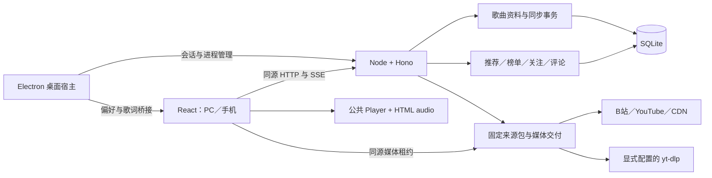

# 架构与数据

当前模块、运行链路与持久化规则。HTTP 字段及限额见[接口说明](接口说明.md)，操作见[产品功能](../产品/产品功能.md)。

[运行](#当前运行结构) · [模块](#目录和职责) · [播放](#取源与播放链路) · [性能](#桌面资料与界面性能) · [存储](#数据归属) · [模型](#歌曲模型与桌面持久化) · [歌词](#歌词会话与渲染) · [并发](#写入与并发) · [生命周期](#身份与生命周期)

## 当前运行结构

服务从 `dist/server/index.js` 启动并提供 `dist/client`，网页与接口同源；`npm start` 只运行已有构建，当前无独立前端开发代理。

Windows 宿主用普通 Node 启动或复用归属自身 `data/` 的回环服务，不继承服务版配置。歌词窗口只消费主播放器的歌词与时钟，不创建音频或访问业务接口。主窗口和歌词窗口保留沙箱、上下文隔离及导航检查，IPC 校验窗口、主框架和预期 URL。

## 目录和职责

| 位置 | 职责 |
| --- | --- |
| [App.tsx](../../src/App.tsx) | 页面、会话、共享状态、搜索与歌曲操作装配 |
| `src/EntryGate.tsx`、`startup.ts` | 访问策略、并行预加载和首页请求交接 |
| `src/MobileChrome.tsx`、`MobileSettings.tsx`、`MobilePlayer.tsx` | 移动专用布局与导航 |
| [playback.ts](../../src/playback.ts)、[playback-recovery.ts](../../src/playback-recovery.ts) | 队列、准备／提交、暂停意图及恢复 |
| `src/PlayingArtwork.tsx`、`audio-analysis.ts` | 六种展示、独立偏好和惰性 Web Audio 分析 |
| `src/useLyrics.ts`、`DesktopLyricsView.tsx`、`desktop-lyric-engine.ts` | 当前来源歌词会话、展示与 AMLL 适配 |
| [server/index.ts](../../server/index.ts) | 中间件、身份、路由、模块装配和退出 |
| `server/song-library-*.ts` | 歌曲事务、来源保存、目录、维护、备份、整理和同步 |
| `server/bilibili-accounts.ts`、`bilibili-credentials.ts` | 账号与 Windows 凭据 |
| `server/discovery-batches.ts`、`recommendation.ts` | 推荐批次、规则与执行 |
| `server/charts.ts`、`creator-sources.ts`、`follows.ts`、`comments.ts` | 榜单、作者、关注和评论 |
| `server/lyrics-*.ts`、`startup-settings.ts`、`source-settings.ts` | 歌词、访问／欢迎及来源设置 |
| [desktop/](../../desktop) | 窗口、宿主桥接、本地偏好和生命周期 |
| [scripts/](../../scripts)、[tests/](../../tests) | 构建维护与单元／服务／浏览器／原生回归 |
| [vendor/](../../vendor) | 固定安装包、对应源码及来源记录 |

`server/` 也含可被浏览器导入的纯类型和计算模块，目录名不等于远端部署边界。

## 公共包边界

| 包 | 职责 |
| --- | --- |
| `@studio/player` | 播放状态、队列、媒体会话、睡眠及来源契约 |
| `@studio/music-sources` | 来源身份、元信息、目录、音轨准备、协议和媒体交付 |
| `@studio/recommendation` | 推荐规则与执行 |

歌曲资料由产品的 `SongLibraryStore/Service/Sources` 维护。固定版本见[依赖清单](../参考/依赖清单.md)，重建见 [vendor/README](../../vendor/README.md)。公共包不通过相邻项目源码导入；源码快照仅作对应版本交付。

## 取源与播放链路

### 媒体准备与失败恢复

1. 客户端建立访问会话并完成来源握手。
2. 保存稳定来源引用；B站分 P 经元信息取得实际 cid。
3. `BestAudioBridge` 按浏览器解码能力选择音轨，服务准备来源。
4. `PlaybackDelivery` 发布同源短期租约，服务携必要来源头读取 CDN，处理 Range、取消及释放。
5. player 交给唯一 `<audio>`；地址刷新恢复现场进度与最新暂停意图。

媒体失败前保存实际位置和意图，手动重试使用已提交确切来源，不重选默认版本。新选择、停止或取消使旧准备失效并释放迟到计划。队列持久化只保存静默状态，不保存媒体租约或故障进度。

音波首次使用时连接同一音频的 Web Audio 分析图，原媒体输出与分析分支共存；每个播放器只绑定一次。采样不进入 React 状态，绘制约每秒最多 30 帧，隐藏或离开展示时停止绘制。

### 桌面自动匹配

宽屏客户端提交 `searchMode` 和实际解码能力，先查歌名与歌手，再按需回退歌名；按平台顺序检查合格候选。公开搜索、分区与元信息匿名读取，需要账号权限的取流由宿主提供凭据。

严格规则核对完整／短歌名边界、全部请求歌手、实际演唱者、版本及已知时长；已知时长容差为 max(12 秒，8%)。上传者和原唱署名不推断为翻唱演唱者，明确指定版本不静默换源。

自动候选读取最多 1024 字节并核对容器标记，单候选最多 10 秒；音轨明确失效可继续同视频其他音轨及后续候选，网络、登录、限流和服务故障停止。首段可读不保证整曲或解码成功。成功音轨随临时 `verifiedAudio` 交给播放器，本次首播及地址刷新沿用，新选择重新检查。

### 桌面预算与在途共享

桌面来源读取进入独立准备上下文，资料写入、导入、媒体及租约使用各自规则。移动请求保持独立路径。

| 资源 | 边界 |
| --- | --- |
| 来源／点播操作 | 60 秒；解析 60 秒，首播与卡顿各 30 秒 |
| 来源等待队列 | 最多 64 项；B站普通／点播槽 3／4，YouTube 为 1／2 |
| 同次 B站响应复用 | 每份 4 MiB，最多 32 份，总计 8 MiB，操作结束清理 |
| 准备令牌 | 最长 15 秒、最多 32 份，单次消费，绑定会话、来源代次、确切引用及音轨 |
| 在途共享 | 最多 64 份，不保存完成值或正式租约；最后等待者退出才取消生产者 |
| 诊断 | 服务保留 160 条安全事件、客户端 120 条；窗口样本统计 p50／p95，临时操作编号关联来源请求、恢复和释放，不含曲目身份、凭据和媒体 URL |

共享身份包含会话、账号／来源代次、确切参数、匹配修订及解码能力。取消独立生效；会话撤销、来源变化和退出取消所属工作，迟到结果不提交。实现见 [desktop-playback.ts](../../server/desktop-playback.ts) 与 [desktop-inflight.ts](../../server/desktop-inflight.ts)。

### 惰性队列、预取与唤醒

桌面播放全部先建立最多 500 个惰性项，仅选中项读取元信息；回收时保留队列、恢复项、当前计划、暂存版本及准备项。局部准备失败可跳过，网络／身份等整体错误停止，已提交媒体失败保留当前项供恢复。

[下一首预取](../../src/desktop-continuity.ts)只在剩余不超过 8 秒且已缓冲到尾部时运行，对已知确切来源准备一份原始音轨，不验证首段或发布租约。至多一项，6 秒预算、10 秒缓存；新选择、队列／来源变化、暂停、断网和退出取消或丢弃，结果只交给同一队列项与来源。

[恢复控制器](../../src/playback-recovery.ts)合并联网、可见及原生唤醒事件；休眠前记录真实位置和意图。健康播放不取源，失败、过期或 1.5 秒无推进才准备同来源。恢复预算 30 秒、至少间隔 10 秒、每次选择最多两次，避让已有刷新并服从最新暂停意图。

[恢复诊断](../../src/playback-diagnostics.ts)按每次选择分配临时编号，关联媒体错误、检查点、来源准备、定位事件及租约释放。单曲点播和版本切换在准备前取得独立编号，提交时沿用；准备期间旧媒体仍保留原编号，取消或失败不切换当前归属。HTTP 请求保留独立编号与服务操作号，响应前的网络失败、超时和取消分别记录。应用新计划只表示来源已提交，实际定位与恢复播放由媒体事件确认。迟到租约的释放沿用创建时编号；诊断不改变公共调用结果或发送追踪请求，租约路径中的令牌不会进入记录。

### 来源核验与媒体超时

桌面媒体采用连接 30 秒、首字节 30 秒、空闲 120 秒，不设机械总寿命；正常收数重置空闲，客户端背压不算上游停流。移动端使用原总寿命。

YouTube 桌面 resolver 随来源代次创建／销毁，formats／prepare 最多复用 8 份、5 秒，按 scope、来源、凭据及有效期隔离，地址到期前一秒失效。默认 resolver 不复用。

## 桌面资料与界面性能

文件 SQLite 的快照、普通 `/edits` 和备份导出由[工作线程](../../server/song-library-worker.ts)完成读取、校验、事务及响应编码，每个存储惰性创建一线程，最多 16 个未完成请求。提交前检查共享取消标记，名额到实际结束才释放；导出沿用原快照格式与字节上限，取消后不交付结果。线程失败不重放写入，退出等待线程停止。内存夹具和移动路径仍用原实现。

快照按 SQLite 修订缓存编码字节，后台目录处理复用未变化快照；达到 1000 首或 4000 版本时，播放／准备期间延后自动目录回填。同步状态和预览按歌曲、版本与成员建立本次查询索引，保留确切来源和既有映射。同步事务、导入预览等整库操作仍在服务线程执行，保留计算及写锁成本；性能测量方法见[验证规范](验证规范.md#整库操作与播放延迟)。

[独立时钟](../../src/playback-clock.ts)由进度、歌词和浮窗局部订阅，普通时间推进不更新应用外壳。歌曲管理、封面及版本／歌词共用按需模块；加载失败可换模块 URL 重试。[区域错误边界](../../src/DesktopRegion.tsx)隔离页面渲染失败，恢复不重建播放器，但未保存草稿可能丢失。

## 数据归属

`database` 和 `runtimeDirectory` 由配置文件目录解析，启停与诊断使用同一配置。独立桌面数据库位于 `data/library/`，偏好使用 `data/preferences.json`；完整目录见[运行维护](../运维/运行维护.md#实例目录)。

| 数据 | 服务端位置 | 共享／备份 |
| --- | --- | --- |
| 歌曲、版本、收藏、成员、贡献、同步映射和事件 | `database + '.song-library.sqlite'` | 同用户空间共享，可移植部分进入歌曲 JSON |
| 手动收藏／歌单封面 | 歌曲快照的 `desktopFavoritesCover/desktopCover` | 512px JPEG data URL，字符串最多 512 KiB，随快照恢复，手机不采用 |
| 推荐配置 | `.recommendation.sqlite` 后缀 | 同服务共享，不在歌曲 JSON |
| 应用关注 | `.follows.sqlite` 后缀 | 同服务共享，不在歌曲 JSON |
| 来源、搜索、访问及欢迎设置 | `.settings.sqlite` 后缀 | 同服务共享，欢迎页另可导出 |
| 浏览、发现及榜单缓存 | `.browse-cache.sqlite` 后缀 | 成功内容缓存 |
| 歌词选择、偏移和正文缓存 | `.lyrics.sqlite` 后缀 | 按确切来源保存，完整实例备份保留 |
| B站凭据 | `runtimeDirectory/bilibili-account.dpapi.json` | Windows 当前用户加密，不在歌曲 JSON |
| 服务 PID／控制状态 | `runtimeDirectory/service.json` | 当前实例控制，不作为可迁移资料 |
| 日志与关闭诊断 | runtime 或显式日志目录 | 运维输出 |
| 会话、分页和预览任务 | 进程内存 | 重启失效 |
| 队列、主题、展示及地区偏好 | 当前浏览器存储 | 浏览器独立；Electron 经白名单桥接保存到 data |

表中简写后缀均追加到 `database`。桌面 profile 与系统浏览器独立，不自动读取其 Cookie 或 localStorage。

## 歌曲资料模块接口

| 模块 | 职责 |
| --- | --- |
| `SongLibraryStore` | 修订查询、严格聚合校验、条件事务及事件 |
| `SongLibraryService` | 编辑、备份、维护／整理预览和受信事务 |
| `createSongLibraryRouter` | 挂载 `/api/song-library`，复用身份、同源、请求取消 |
| `SongLibrarySources` | 来源规范化与保存、榜单收藏、播放选择 |
| `SongLibraryMaintenance` | 失效检查、合并／移动／删除影响规划 |
| `planSongOrganization` | 从已存事实生成有界建议，人工逐字段采用 |
| `SongLibrarySync` | 关联、成员映射、远端观察与持久意图 |
| `SongLibraryPage/SongBackupPanel` | 同一资料状态及修订上的编辑和导入 |

类型见 [song-library-types.ts](../../server/song-library-types.ts)，HTTP 编辑边界见 [song-library-edits.ts](../../server/song-library-edits.ts)。可移植 snapshot 与含贡献／映射的内部 document 分开，HTTP 不接受任意 reducer 或同步权限。

## 歌曲模型与桌面持久化

歌曲有稳定 ID、标准资料和人工字段保护。同名不自动合并；确切来源（B站 BV＋cid／YouTube 视频 ID）在同用户空间只归属一个版本。收藏幂等，歌单成员有独立身份和顺序，可重复及固定版本。

选择顺序为本次明确版本、成员固定、歌曲默认、临时搜索。切换先准备再按代次、队列实例和最新意图提交；失败保留原声音，成功从头播放。改默认不打断当前音频。

快照为 `slowtune-library` 版本 1，包含 songs、versions、favorites、playlists、catalogLinks、redirects；导入导出严格检查关系与 64 MiB 原始 UTF-8 上限。详细字段和冲突规则见[歌曲资料路由](接口说明.md#歌曲资料路由)。

桌面偏好、窗口／浮窗状态和欢迎图异步合并、串行原子写入；确认表示对应或更新修订已落盘。失败保留内存最新值和成功文件。状态文件只有不存在时用默认，损坏或读取失败保护原件并阻止正常启动。

## 歌词会话与渲染

全局控制器按确切来源管理选择、请求和草稿。实际播放加载后先读已选歌词，再按资料自动匹配；静默队列恢复不查询。切换来源取消旧请求，页面与展示切换不重复查询，迟到结果不覆盖保存。

歌词选择及偏移使用独立修订；正文快照不因提供方缓存变化而改写，也不隐式创建歌曲或收藏。选择最多 5000 个来源；正文缓存最多 200 份／24 小时，搜索缓存 100 组／10 分钟，LRCLIB 临时候选正文 48 份／10 分钟。部分失败不缓存。

桌面手动搜索以 NDJSON 完整快照逐步返回，不自动采用最快结果；最多共享 64 份在途任务，调用方独立取消。HTTP／搜索／正文预算为 20／18／15 秒，单次上游 12 秒；网易云可信候选元信息最多 96 份／10 分钟，自动采用等待完整候选。

所有视图读取同一媒体实际时钟，不累加墙钟或重复乘倍速。底部／手机歌词局部绘制扫色；桌面沉浸按需加载固定 AMLL，Shadow DOM 隔离样式。真实逐字数据按时间推进，沉浸普通 LRC 传整句；纯文本不模拟同步。暂停、隐藏与减少动态时按视图规则停止连续动画，重显按媒体位置校正。

手动阅读 5 秒后恢复，渲染失败保留可定位正文；沉浸视图状态仅在 App 内存，离开播放或进入移动断点清除。版本及许可见[依赖清单](../参考/依赖清单.md)和[第三方声明](../../第三方声明.md)。

## 写入与并发

同用户空间的资料、成员、贡献、映射和待处理事件共同保存在严格聚合中。`BEGIN IMMEDIATE` 内比较不透明修订、校验关系、写资料与事件、提交前检查取消；失败回滚。仅接受当前数据结构，不提供历史转换或双写。

网页首次异步读取，后续约每 5 秒及恢复可见时查轻量修订；变化才取完整快照。读写序号阻止迟到读取覆盖新状态，冲突保留修改字段草稿，核对后用当前修订重试。批量来源只为新引用或未解析 BV 查询元信息，事务再次检查归属及账号／来源代次。

备份恢复的成员形成独立本地贡献；替换清理失效映射，相关关联转待确认，不恢复远端删除权限。导入、维护和整理预览归属会话，退出、撤销、到期或停服时清理。

同步映射绑定账号、关联、具体成员与 BV，远端投影 BV 集合。远端删除只解除该关联贡献，无其他贡献的成员才移除；歌曲和版本保留。改资料／默认不重建映射，未映射成员须确认。

远端与 SQLite 无跨平台原子事务。发送前持久化意图，每次异步步骤复核关联、账号代次、映射与事件；重试先完整观察远端，再决定是否发送。新建结果不确定只核对唯一匹配，不盲目重建。暂停保留有效意图，解除关联将成员转本地且不删远端。

## 身份与生命周期

访问会话使用内存状态及 HttpOnly、SameSite=Strict Cookie，Secure 取决于请求协议。Host、Origin、业务写入标识和控制密钥分别校验；服务访问身份与 B站账号独立，用户空间只由配置决定。

桌面宿主只管理自己的服务与 data，普通网页不建立宿主订阅。服务／网页构建时间戳用于陈旧检测，诊断不把时间戳当作内容校验。

停服先拒绝新业务，关闭事件流、取消任务，再释放媒体、工具和数据库，仅删除仍归属自身的记录。桌面退出先保存、释放播放器、再保存、核验归属并停服，最后等待停服期间写入。失败提供重试；播放器释放后进入退出恢复页，强制结束和断电不属于正常退出保证。

## 当前平台耦合

Node 内置 SQLite、Windows DPAPI／PowerShell、外部取源工具、启动脚本和部分 Edge／Electron 测试依赖实际宿主平台。当前控制脚本使用 IPv4 回环，其他系统适配及实体设备验证见[当前限制](../产品/当前限制.md)。
